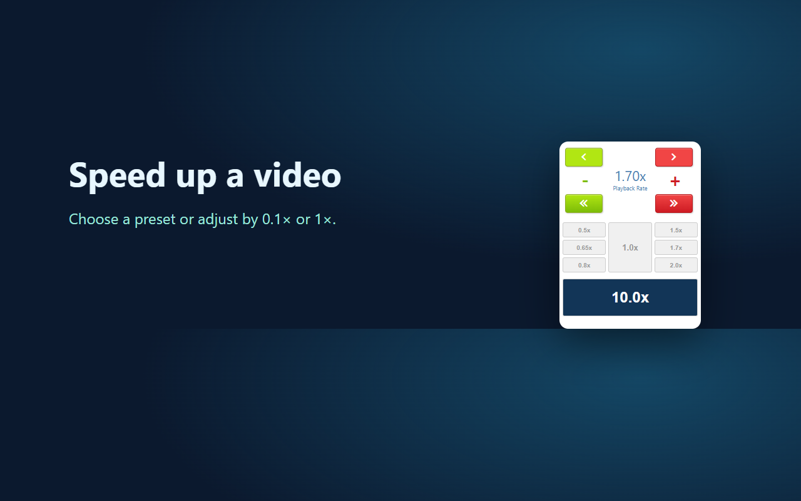

# Media Playback Speed

[Русский](README.md)

A Chromium browser extension for changing HTML5 video and audio playback speed in the current tab. Speed through long recordings or slow down a video to catch the details. Pick a preset in the extension popup or use keyboard shortcuts while watching. The toolbar icon shows the current speed when it differs from 1×.



## Installation

Download the ZIP from [GitHub Releases](https://github.com/WeslyG/media-playback-speed/releases), extract it, and load the folder containing `manifest.json` with **Load unpacked** in developer mode at `chrome://extensions`.

## Controls

- The popup offers presets from 0.5× to 10× and a 1× reset button.
- **Alt + Shift + ← / →** decreases or increases speed by 0.1×.
- **Alt + Shift + ↓ / ↑** decreases or increases speed by 1×.
- The extension supports HTML5 players in accessible embedded frames, including players in open Shadow DOM.

## Development and builds

Linux is the primary build environment, including WSL. You need Node.js 24, npm, and `zip`. With the Dev Containers extension in VS Code, open the project with **Reopen in Container**. The container installs the tools and dependencies while the browser can run on the host.

```bash
npm ci
npm run lint
npm run build
```

The build creates `dist/media-playback-speed-<version>.zip`. During development, load `extension/` as an unpacked extension and reload it on the extensions page after edits. GitHub Actions runs Oxlint and builds the ZIP on pushes to `main` and pull requests. A `v<version>` tag triggers a release when the version matches the manifest.

Player state is processed locally. [Privacy policy](store/PRIVACY.md) · [Changelog](CHANGELOG.md)
