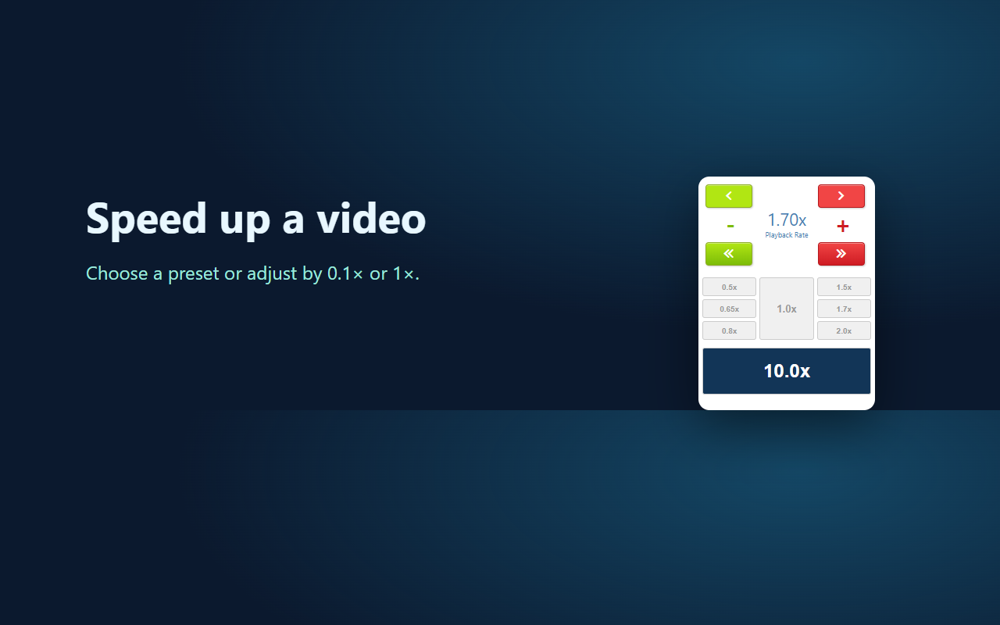

# Media Playback Speed

[English](README.en.md)

Расширение для Chromium-браузеров, которое меняет скорость HTML5-видео и аудио на текущей вкладке. Ускоряйте длинные записи или замедляйте видео, чтобы разобрать детали. Выберите готовую скорость в меню расширения или меняйте её горячими клавишами прямо во время просмотра. Значок на панели браузера показывает текущую скорость, когда она отличается от 1×.



## Установка

[Установить из Chrome Web Store](https://chromewebstore.google.com/detail/media-playback-speed/nogakpkmohhjejmlaeneehgchaghpbbn)

Скачайте ZIP из [релизов GitHub](https://github.com/WeslyG/media-playback-speed/releases), распакуйте его и загрузите папку с `manifest.json` через **Загрузить распакованное расширение** в режиме разработчика на странице `chrome://extensions`.

## Управление

- В меню расширения есть готовые скорости от 0,5× до 10× и кнопка сброса на 1×.
- **Alt + Shift + ← / →** уменьшает или увеличивает скорость на 0,1×.
- **Alt + Shift + ↓ / ↑** уменьшает или увеличивает скорость на 1×.
- Расширение поддерживает HTML5-плееры в доступных вложенных фреймах, в том числе плееры с открытым Shadow DOM.

## Разработка и сборка

Основной путь — Linux, в том числе WSL. Нужны Node.js 24, npm и `zip`. В VS Code с расширением Dev Containers можно открыть проект через **Reopen in Container**. Контейнер установит инструменты и зависимости, а браузер может работать на хосте.

```bash
npm ci
npm run lint
npm run build
```

Сборка создаёт `dist/media-playback-speed-<версия>.zip`. Для разработки загружайте папку `extension/` как распакованное расширение и обновляйте его на странице расширений после правок. GitHub Actions запускает Oxlint и собирает ZIP при push в `main` и в pull request. Тег `v<версия>` запускает выпуск релиза, если версия совпадает с манифестом.

Состояние плеера обрабатывается локально. [Политика конфиденциальности](store/PRIVACY.md) · [История изменений](CHANGELOG.md)
